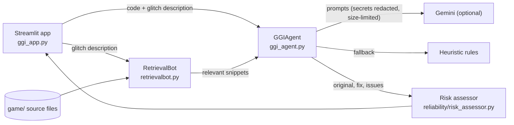

# 🕵️ Game Glitch Investigator (GGI)

An AI-assisted debugging agent that reads Python code, finds likely bugs, proposes a fix, and scores how risky that fix is before anyone applies it. It can also take a plain-English description of a glitch ("the score goes negative after a wrong guess"), search a codebase for the code involved, and use what it finds as context.

## Original project (Modules 1-3)

This project grows out of **Game Glitch Investigator: The Impossible Guesser**, a Streamlit number-guessing game that shipped full of bugs on purpose. The original goal was to play the broken game, work out what was wrong, and fix it with an AI assistant (Claude Code) while keeping notes on how that went. Some of the bugs:

- the Enter key did not submit a guess
- attempts were counted wrong
- the Higher/Lower hints pointed the wrong way
- the game could not be restarted

This project turns that debugging workflow into a tool: instead of a person hunting for glitches, an agent analyzes the code, a retriever finds the relevant parts of the game, and a guardrail decides whether a fix is safe.

## What it does and why it matters

AI-generated fixes are easy to get and easy to trust too much. GGI treats a fix as something to be checked, not applied blindly:

1. **Analyze**: find issues, using either an LLM (Gemini) or a set of offline rules.
2. **Fix**: propose a rewrite, using either the LLM or offline fixers.
3. **Check**: score the fix with a risk assessor and say whether it is safe to auto-apply or needs a human.

The point of the offline mode is that the whole workflow runs with no API key, so it is testable and predictable. The LLM mode is an upgrade, and falls back to the offline rules if the API fails or returns something unusable.

## Architecture overview

Full diagrams: [diagrams/system_diagram.mmd](diagrams/system_diagram.mmd) (classes and relationships) and [diagrams/data_flow.mmd](diagrams/data_flow.mmd) (how data moves). The short version:



- **`GGIAgent`** runs a Plan → Analyze → Act → Test → Reflect loop and keeps a trace log of each step. If a Gemini client is configured it uses prompt templates from [prompts/](prompts/); otherwise (or on any API error or unparseable reply) it uses the heuristic rules.
- **Heuristic rules** are a table of detector and fixer pairs in `ggi_agent.py`: `print` to `logging`, bare and silent `except`, mutable default arguments, missing `requests` timeouts, `== None`, `is` with literals, leftover debuggers, hardcoded secrets, plus flag-only checks such as `eval`, `open()` without `with`, and off-by-one `range`.
- **`RetrievalBot`** reads `game/` (including subfolders), splits Python into one chunk per function and text files into paragraphs, builds a word index, and returns the best-matching chunks for a query.
- **Safeguards around the LLM:** before anything is sent to Gemini, `reliability/redaction.py` replaces likely secrets with placeholders (and restores them in the returned fix), code over 20,000 characters is never sent, and every fallback to the offline rules is logged and shown in the app.
- **Risk assessor** starts at 100 and subtracts points for severe issues, shrinking code, and removed `return` statements. Only a low-risk result is marked as safe to auto-apply.
- If you describe a glitch but paste no code, the app analyzes the Python chunks it retrieved from `game/`.

## Setup instructions

Requires Python 3.10 or newer.

1. Install dependencies:
   ```bash
   pip install -r requirements.txt
   ```
2. *(Optional, for Gemini mode)* create a `.env` file next to `ggi_app.py`:
   ```
   GEMINI_API_KEY=your-key-here
   ```
   Skip this step to use offline mode only. In Gemini mode your code, glitch description and retrieved snippets are sent to the Gemini API; likely secrets are replaced with placeholders first, but that is best-effort, so don't paste confidential code (see [model_card.md](model_card.md)).
3. Start the app:
   ```bash
   python -m streamlit run ggi_app.py
   ```
4. In the sidebar, pick **Heuristic only (no API)** or **Gemini**. Then load a sample snippet, browse a file from `game/`, or paste your own code, optionally describe a glitch, and click **Run Game Glitch Investigator**.
5. Run the tests:
   ```bash
   python -m pytest tests
   ```

There is also a command-line retrieval tool: `python rag_main.py` (naive, retrieval-only and RAG modes; the naive and RAG modes need `GEMINI_API_KEY`).

Ready-made inputs for every rule are in [sample_code/](sample_code/) and in the app's sample dropdown.

## Sample interactions

The first two use the offline analyzer and fixer (`GGIAgent()` with no client), so they are reproducible without a key.

### 1. Mixed issues: [sample_code/mixed_issues.py](sample_code/mixed_issues.py)

**Input**
```python
# TODO: Replace this with real input validation (this comment is intentional)

def compute_ratio(x, y):
    print("computing ratio...")

    try:
        return x / y
    except:
        return 0
```

**Output**
- Issues: `Code Quality | Low` (print), `Reliability | High` (bare `except:`), `Maintainability | Medium` (TODO)
- Proposed fix:
  ```python
  import logging

  # TODO: Replace this with real input validation (this comment is intentional)

  def compute_ratio(x, y):
      logging.info("computing ratio...")

      try:
          return x / y
      except Exception as e:
          # [Game Glitch Investigator] log or handle the error
          return 0
  ```
- Risk: **HIGH, score 30, auto-fix: NO.** A high-severity issue was involved, so the guardrail asks for human review even though the rewrite looks reasonable.

### 2. Network call with no timeout: [sample_code/network_no_timeout.py](sample_code/network_no_timeout.py)

**Input**
```python
def fetch_leaderboard(url):
    response = requests.get(url)
    return response.json()

def submit_score(url, player, score):
    return requests.post(
        url,
        json={"player": player, "score": score},
    ).status_code
```

**Output**
- Issues: `Reliability | Medium` (requests call without a timeout)
- Proposed fix: `requests.get(url, timeout=10)` and `requests.post(..., timeout=10).status_code`. The call that spans several lines and is followed by `.status_code` is handled correctly.
- Risk: **LOW, score 80, auto-fix: YES.**

### 3. Glitch description with no code

**Input** (code box empty; description): `the score goes negative after a wrong guess`

**Output (offline mode)**
- The retriever searches `game/` and returns `app.py (module/class level)`, `README.md (paragraph 8)` and `app.py (parse_guess)`. The app reports that it is analyzing the retrieved Python code, and lists the retrieved chunks in an expander.
- Issues: `User Report | Info`, which records the description. Offline rules cannot reason about a free-text report, so it says to use Gemini mode or review manually.
- In Gemini mode the description and the retrieved snippets are added to the analyzer and fixer prompts. I have not captured Gemini output for this README, so I am not showing a claimed result here.

## Design decisions and trade-offs

- **Offline-first, LLM as an upgrade.** Every LLM call has a heuristic fallback. The cost is that the offline rules are shallow, since they are regexes and cannot understand intent. The benefit is that the workflow is testable, free, and never blocked by an API limit.
- **A rule table, not scattered `if`s.** Each rule is a detector, an optional fixer and metadata. Adding a check is one row. Fixers run only for rules that actually fired, and are written to be no-ops when their pattern is absent.
- **Fixes only where they are safe.** Only some rules auto-fix (for example `== None` to `is None`). Rules like `eval()` or `while True:` are flag-only because a mechanical rewrite could change behavior.
- **Risk assessment is separate and explicit.** The score is a plain, readable formula, not another model call, so you can see exactly why a fix was or was not approved. The trade-off is that it is crude: it counts severities and checks simple structure, and cannot judge whether a fix is *correct*.
- **Retrieval is deliberately simple.** Keyword overlap over chunks, with a stopword filter, no embeddings. That keeps it dependency-free and explainable, but a vaguely worded glitch gets rough matches.
- **Chunk by function.** Retrieving a whole file would drown the useful part, so Python files are split by function and method using the `ast` module, and prose by paragraph.
- **Glitch-only mode analyzes fragments.** When there is no code, the agent works on the retrieved chunks joined together, so the resulting fix is a diagnosis aid, not something to paste back into one file.

## Testing summary

**What passes**
- `tests/test_risk_assessor.py`: 4 of 4 tests pass (no-fix is high risk, minimal change is low risk, a high-severity issue lowers the score, a removed `return` is penalized).
- `tests/test_agent_workflow.py`: 4 of 4 tests pass (offline run returns the expected shape, detects `print`, proposes a logging fix, and falls back to heuristics when the client returns non-JSON).
- `tests/test_safety.py`: 15 of 15 tests pass (secrets are redacted before anything is sent to the LLM and restored in the fix, size limits hold, every fallback to the offline rules is logged, injection text stays in the data part of a prompt, and analyzed code is never executed). The tests use a stand-in client, not the live Gemini API.
- I also checked, by running scripts and the Streamlit test harness, that every sample in `sample_code/` produces the expected issues, that each fixed file is still valid Python, that the file browser loads files, and that glitch retrieval feeds the agent. Those checks are not yet in the test suite.

**What did not work, or is still open**
- `game/tests/test_game_logic.py` fails (3 of 3) because `game/logic_utils.py` still contains the starter stubs that raise `NotImplementedError`. The game's fixes live in `game/app.py`, so the planned refactor into `logic_utils.py` was never finished in this copy.
- In the app's **Heuristic only** mode the app uses `MockClient`, whose fixer reply is a placeholder comment, not a real rewrite. The analyzer still falls back to the rules, but the proposed "fix" is that placeholder and gets flagged HIGH risk. The working offline fixes in the samples above come from running the agent with no client. This needs a decision before I would call the app's offline mode finished.

**What I learned**
- Small string-level assumptions break things: a fixer that hardcoded indentation, a retriever that matched on the word "the", and an evaluation script that compared filenames against chunk labels and so could never register a hit. Each was found by running the code on a real example, not by reading it.
- Testing a "fixer" means checking that its output still parses and that re-running the analyzer on it reports fewer issues, not just that it ran.

## Reflection

Building this showed me that the useful part of an AI system is often everything around the model: the fallbacks for when it fails, the checks on what it returns, and the context you give it. Writing the offline rules first meant I always had a working baseline to compare the LLM against, and the risk assessor made "should I trust this fix?" a question with a visible answer. It also made me more careful about the gap between "the code ran" and "the result is right", which is why most of the bugs I found came from running real inputs.

My fuller responsible-AI reflection (how I collaborated with AI, a suggestion I accepted and one I revised, and the system's limitations) is in [model_card.md](model_card.md).

## Project layout

| Path | What it is |
|---|---|
| `ggi_app.py` | Streamlit UI |
| `ggi_agent.py` | Agent workflow and heuristic rules |
| `retrievalbot.py` | Chunking, indexing and retrieval over `game/` |
| `llm_client.py` | `MockClient` and `GeminiClient` |
| `reliability/risk_assessor.py` | Fix risk scoring |
| `prompts/` | Analyzer and fixer prompt templates |
| `sample_code/` | Inputs that exercise each rule |
| `game/` | The original buggy-then-fixed guessing game |
| `diagrams/` | Mermaid class and data-flow diagrams |
| `tests/` | Pytest suite |
